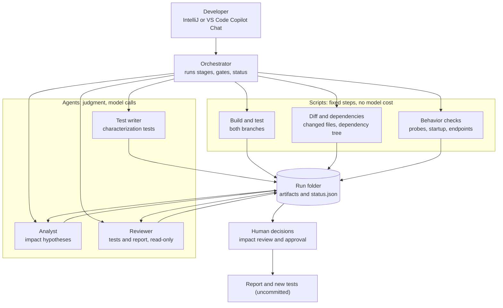

# Spring Boot Migration Impact Check: Approach

## 1. Purpose

For any Spring Boot or Java migration, whether a version upgrade, a dependency or BOM change, a framework migration, or a change made by hand, a script, a migration tool, or AI:

- Identify the potential impact of the changes, with test cases that prove or disprove each one.
- Suggest which flows to regression-test, to reduce regression time without reducing safety.
- Produce a simple report of the changes and their impact.

The check answers four questions:

1. What changed between master (baseline) and change_branch (candidate)?
2. What could each change do in production?
3. What is proven by a test, and what still needs a person?
4. Which flows must be regression-tested, and which can be covered by automated evidence?

## 2. Architecture

- **Scripts** produce the facts: build results, diffs, dependency trees, API diffs, test comparisons, coverage, and the verdict arithmetic. They run the same way every time.
- **Agents** interpret the facts and draft tests. Their output is stored as a proposal and checked by the scripts before it counts.
- **The run folder** is the shared memory. Every step reads from it and writes to it, which is what makes steps independent and resumable.
- **Humans** decide at two points: after the impact findings, and before the verdict is final.

Runs locally on Windows with no CI. Build prerequisites (Maven settings, JDKs, Docker for Testcontainers) are the developer's responsibility and are checked in Phase 0.

## 3. Principles

- **The target is the changed files between the two branches.** Impact is traced outward from those files to the code and flows that use them.
- **The diff shows where; tests show what changed.** Dependency and framework changes alter behavior without touching our code, so dependencies and runtime are checked too.
- **Origin does not matter.** The same checks apply whatever made the change. If the source is known, it is recorded; it does not change the analysis.
- **Master is the reference.** New tests are written against master's behavior, then run on change_branch.
- **A test must be able to fail.** A test that passes for every input on both branches is discarded.
- **Evidence over opinion.** An agent may propose hypotheses. A hypothesis counts only when a test or probe confirms it.
- **Unknown is not safe.** Code that no test reaches is reported as untraced, never as passing.
- **A PASS is not proof.** The report states what was checked and what was not.
- **Cost reduces repetition, never checks.** See section 14.

## 4. Inputs

- Config: branch names, JDK per branch, Maven settings, test commands, thresholds, output folder, rule versions, agent call budget.
- The repository with both branches.
- Optional: probe manifest, sanitized production samples, a previous-schema database snapshot.
- Owners: who runs the check, who reviews the new tests, who accepts risk.

## 5. Outputs

- `report.md` and `report.html`: the simple impact report (section 8).
- `findings.json`: the single source of truth that the report is generated from.
- `status.json`: live progress, step states, and per-run agent usage.
- `artifacts/`: diffs, dependency trees, API diffs, test comparisons, bean and property dumps, probe outputs, agent outputs with their input hashes.
- The validated new tests, placed uncommitted in the change_branch worktree of the run, with a patch file (`artifacts\new-tests.patch`). Nothing is committed and no branch is created; change_branch itself is not modified.

## 6. Prerequisites (Phase 0)

Checked by the script before any step runs. The run stops with a clear message if any is missing.

- Git, with both branches available locally.
- JDK for each branch, and Maven with the project's settings file.
- Docker is not used on this machine. Phase 5 Testcontainers needs a different approach, to be decided before Phase 5.
- Network access to the Maven repository.
- Copilot Chat available in the IDE, if agent steps are used.
- Configured owners for review and risk acceptance.

## 7. Phases

Each phase is a step that can run on its own, reads its inputs from the run folder, and writes its outputs there.

| Phase | What happens | Output |
|---|---|---|
| 0. Setup | Validate config and prerequisites, create run folder, worktrees for both branches, record environment (JDK, Maven, tool version, commit hashes) | Run folder, environment record |
| 1. Baseline tests | Build and test both sides in parallel; compare results by test name. Flaky tests are retried, then quarantined; they do not drive the verdict. | Test comparison |
| 2. Changed files | Collect the diff with renames detected. Classify each file: main code, test, build/dependency, config, formatting-only. Check test diffs for removed or weakened assertions. Extract changed methods, signatures, annotations, defaults, and removed branches or catch blocks. If the source of a change is known, group by it. | Change inventory |
| 3. Dependencies and API | Compare the resolved dependency tree on both sides, including transitive and BOM-driven changes. Run dependency analysis for unused, undeclared, and conflicting dependencies. Compare public APIs and the old and new jars of each upgraded library. | Dependency and API diffs |
| 4. Impact evaluation | Apply pattern rules; emit one finding per match with severity. Map each flagged symbol to the entry points that reach it at runtime: enumerate endpoints, scheduled jobs, and listeners, and map them to the tests that execute the symbol (per-test coverage). Mark flagged code no test reaches as untraced. | Findings with severity, reach, and coverage |
| 5. Behavior tests | Run Spring Boot integration tests on both sides (Testcontainers with production-like versions; WireMock for external services). Startup smoke check: context loads, health is UP, startup time and heap recorded. Diff bean and property dumps. Compare key endpoints. Run migrations from a previous-schema snapshot and read representative stored data. Write characterization tests on master for flagged flows; run them on change_branch. Confirm each new test fails when its regression is injected. Run mutation testing on changed classes only, on both sides. | New tests, behavior differences |
| 6. Flow selection | Map findings to flows. A flow may be reduced only if all its changed code is covered and traced, and it has no confirmed finding. Otherwise it keeps the full regression. Reduced flows get targeted tests plus a smoke suite. | Flow list with scope and reason |
| 7. Manual review | Each finding that tests cannot decide gets a check, the expected master result, and an owner. | Manual items |
| 8. Output | Write findings.json, the report, the artifacts, and place the validated new tests, uncommitted, in the change_branch worktree of the run (with a patch file). | Report and new tests |
| 9. Test and report review | Agent review first (read-only reviewer that did not write the tests), then manual review by a person. Both decisions are recorded. | Review record |
| 10. Verdict | Set the verdict and exit code. A skipped required stage can never produce PASS. | Verdict |
| After release | Canary or staged rollout, dashboards for error rate and latency, a tested rollback path. Each production incident becomes a new test or rule. Outside the run. | Feedback |

Optional: a load and performance check on critical flows, if thresholds are configured.

## 8. Test rules

- Written on master first, run on change_branch.
- Each test states the change it covers and why it exists.
- Each test is shown to fail when its regression is injected.
- Expected values are not edited after a difference appears without a recorded reason and approval.
- Intended behavior differences are marked and linked to their findings.
- Reviewed by an agent, then by a person.

## 9. The impact report

Kept short. One report, with these sections:

1. **Verdict:** one line with the reason.
2. **Changes at a glance:** counts by category.
3. **Impact findings:** a table with the change, what could happen in production, the evidence (test or probe, pass or fail), and the action.
4. **Flows to test:** each flow, why it matters, and its scope: full, targeted, or smoke. Includes the estimated time saved against a full regression.
5. **New tests:** name, what it covers, result on each side.
6. **Manual decisions:** the question, the expected result, and the owner.
7. **Agent usage:** calls per step and whether outputs were reused.
8. **Evidence:** links to the artifacts behind each finding.

## 10. Verdicts and exit codes

- **Safe:** all required stages ran, no blocking finding, every flow covered. Exit 0.
- **Safe with listed tests:** no blocking finding, but listed tests or manual checks are needed before release. Exit 0.
- **Blocked:** a test regression, a confirmed behavior change nobody has accepted, an unreviewed new test, a probe error, or an unreviewed change. Exit 1.
- **Usage error:** bad arguments or missing files. Exit 2.
- **Tool error:** the tool could not complete. Exit 3.

## 11. Resume and recovery

- Each step declares its inputs and outputs and records a fingerprint: a hash of its inputs, its config section, and the tool version.
- `upgradelens run --resume <id>` skips steps that are done with a matching fingerprint, and reruns the rest.
- Changing an upstream step makes every downstream fingerprint stale, so those steps rerun.
- Outputs are written to a temporary folder and renamed into place. A `done` marker is written last.
- A `running` state with no recent heartbeat is marked `stale` on resume.
- Heavy steps are split into chunks (per module, per test group, per flow), each with its own marker.
- Containers are labeled with the run id, so a rerun can remove leftovers.
- Refused when the config or tool version has changed. The user starts a new run instead.

Commands: `upgradelens status --run <id>`, `upgradelens clean --run <id>`, `upgradelens run --resume <id> --from <step>`.

## 12. Cost and budget

- **Scripts do the deterministic work** at no model cost.
- **Agents are used only for judgment steps**: hypotheses, test drafts, and review.
- **Reuse before re-asking.** An agent output is stored with the hash of its prompt and inputs. Unchanged inputs reuse the stored output.
- **Small, targeted context.** Agents receive the artifacts for one finding or one flow, not the whole repository or full logs. Reviewers receive evidence files, not the author's chat history.
- **Model fit.** A lighter model for mechanical drafting. The stronger model for hypothesis analysis and review. Model availability depends on the Copilot plan and should be confirmed.
- **Per-run budget.** `status.json` records agent calls per step. The run has a cap; when it is reached, the run stops at a clear point and resumes later.
- **Quality stays fixed.** Every flagged change gets a test or probe, every new test gets an agent review and a manual review, and no check is dropped to save cost.

## 13. Reusable components

- Config loader and prerequisite checker
- Run context and stage runner (order, retry, skip, resume)
- Status reporter and budget tracker
- Changed-file index and git diff extractor
- Build runner (per side, per JDK)
- Test comparer, with flaky-test quarantine
- Dependency analyzer
- API differ (japicmp or revapi)
- Rule engine (YAML rules, one family per file)
- Runtime caller mapper (entry point enumeration plus per-test coverage)
- Coverage reader and flow selector
- Integration test runner (Testcontainers, WireMock)
- Probe runner and normalizer
- Mutation runner (changed classes only)
- Test scaffold generator
- Review gate (agent, then manual)
- Report writer (markdown and HTML generated from findings.json)

Each stage reads its config section, writes a named artifact, and records `done`, `failed`, `stale`, or `skipped` with a reason.

## 14. Standards

- Rules are data: YAML with id, pattern, severity, impact, check, and owner. Rules are not tied to any one migration tool.
- One findings model for all outputs.
- Versioned config schema, validated at startup.
- Fixed run folder layout: `config/`, `artifacts/`, `reports/`, `logs/`, `status.json`.
- Timestamped run ids; artifacts named by stage.
- Tool version recorded in every report.
- Secrets never written to status, logs, or reports. Production data is not sent to agents.

## 15. Trust and pilot

Before the reduced scope is trusted, run the check on a past migration with known production incidents. Measure recall (incidents flagged), noise (false alarms), time saved, and escaped defects compared with the full suite. The pilot target is set before the run. Until the pilot meets it, every flow keeps its full regression.

No past incident history is available yet, so the pilot is blocked on finding a candidate migration.

## 16. Limits

- The check covers what the rules, tests, probes, and review cover. A behavior change that none of them targets goes unnoticed.
- Tests and probes cover only the inputs they use.
- Runtime caller mapping only sees code that tests execute. Untraced code is reported as untraced.
- Agent review can be wrong. The review gate blocks unreviewed files and unverified claims, but cannot judge reasoning; the manual review covers that.
- Load, deployment configuration, and real production data volume need separate checks: load testing, staging, canary.

## 17. Build order

1. Scripts for the deterministic phases, starting with Phase 0 prerequisites and Phase 2 diff (reuse UpgradeLens stages where they exist).
2. Run folder, fingerprints, and resume.
3. Review gate for new tests and the report (agent, then manual).
4. Runtime integration checks with startup smoke and dumps.
5. Runtime caller mapping and flow selection with the coverage gate.
6. Mutation testing on changed classes.
7. Analyst and test writer agents, with output caching and budget.
8. Pilot on a past migration.

The tool lives in the UpgradeLens project (`E:\Chiru\AIStuff\upgrade-lens`). Existing stages cover changed files, static pitfalls, dependencies, tests, probes, and the review gate.
